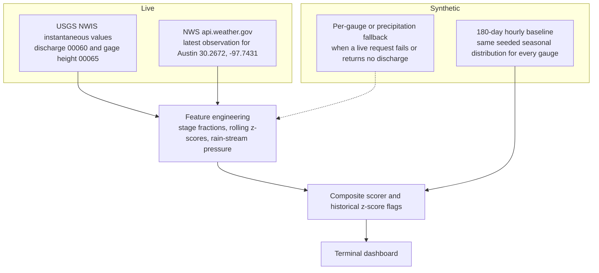

# TxFlood: flood-risk monitor for Austin creeks (USGS + NWS)

[](https://github.com/AhadHashmani/tx-flood/actions/workflows/pytest.yml)


Prototype flood-risk monitor for 6 Austin-area USGS stream gauges, combining live USGS gauge readings and National Weather Service data into a composite risk score with z-score anomaly flags. Historical baselines are currently synthetic; no operational warning accuracy has been validated.

## Why it matters

Central Texas creeks can rise quickly in heavy rain. Residents and city or operations analysts often have to check gauges one site at a time. TxFlood puts six Austin-area gauges in one terminal view: current stage and discharge, a composite score, and z-score flags.

This is an analytics prototype for inspecting that calculation. It is not a flood-warning system. Do not use it to decide whether to evacuate, close a road, or issue a public alert. Nothing in this repository measures warning accuracy.

## What it does

`python main.py` builds a synthetic 180-day hourly baseline, fetches the latest reading for each site, attaches one Austin precipitation observation, scores each gauge, and prints a color terminal dashboard.

### Gauges

Names are the USGS station names for these site numbers. The flood-stage column is a constant in `pipeline/features.py`, not a value read from an agency feed.

| Station | USGS site | Configured flood stage (ft) |
|---|---|---|
| Barton Creek at SH 71 near Oak Hill | 08155200 | 13.0 |
| Colorado River at Austin | 08158000 | 28.0 |
| Shoal Creek at W 12th St, Austin | 08156800 | 9.0 |
| Shoal Creek at Steck Ave, Austin | 08156650 | 8.5 |
| Waller Creek at 38th St, Austin | 08157000 | 7.0 |
| Wilbarger Creek near Pflugerville | 08159150 | 10.0 |

On 21 Nov 2026, the NWIS instantaneous-values service returned discharge and gage height for 08155200, 08156800, and 08158000. It returned no instantaneous series for 08156650, 08157000, and 08159150, so those three rows used the synthetic fallback. That can change when USGS publishes values for them.

### Risk score

Each component is clipped to 0–1, then weighted.

| Component | Weight | Input |
|---|---|---|
| Percent of configured flood stage | 0.40 | Gage height ÷ configured flood stage |
| Discharge z-score | 0.25 | 24-hour rolling discharge z-score, mapped from [-3, +3] to [0, 1] |
| Rain-stream pressure | 0.20 | (6-hour precipitation, inches × flood-stage fraction) ÷ 2 |
| Percent of configured action stage | 0.15 | Gage height ÷ action stage. Action stage is 65% of the configured flood stage |

| Level | Composite score | Also used when |
|---|---|---|
| NORMAL | below 0.35 | — |
| ELEVATED | 0.35 up to, but not including, 0.60 | gage height is at least 45% of the configured flood stage |
| HIGH | 0.60 up to, but not including, 0.85 | gage height is at least 75% of the configured flood stage |
| CRITICAL | 0.85 or higher | gage height is at or above the configured flood stage |

The higher rule wins. A site at the configured flood stage is CRITICAL even when the weighted score is lower.

Basin status is the count of those site levels: any CRITICAL site makes the basin CRITICAL; two or more HIGH sites make it HIGH; one HIGH site, or three or more ELEVATED sites, makes it ELEVATED; otherwise it is NORMAL.

Two different z-scores are printed. The score's z is the 24-hour rolling z-score. The anomaly report is a separate comparison of current discharge with the mean and standard deviation of the synthetic 180-day series for that site. A reading is flagged there when the absolute z-score is above 2.5. The scorer also attaches short flags for a 24-hour z-score above 2.5, a flood-stage fraction above 0.75, an action-stage fraction above 0.90, 24-hour precipitation above 2 inches, or a scaled rain-stream term above 0.5.

## Architecture



The baseline is synthetic on every run, including when the gauge and precipitation requests succeed. A row marked `synthetic fallback` is generated data for that gauge only.

```
.
├── main.py                     snapshot and live refresh
├── ingestion/fetchers.py       USGS NWIS and NWS clients, synthetic fallback
├── pipeline/features.py        stage fractions, rolling stats, feature matrix
├── models/risk_scorer.py       composite score and anomaly detector
├── dashboard/display.py        ANSI terminal dashboard
├── tests/test_pipeline.py
├── requirements.txt
└── .github/workflows/pytest.yml
```

## Example terminal output

Colors are removed below. This is the dashboard from one local run of `python main.py` on 21 Nov 2026. It is not a forecast and not a flood assessment.

Rows marked `synthetic fallback` are generated readings. In this run, USGS returned no instantaneous series for those three site numbers. `Precip 24h: 0.00 in` is a missing National Weather Service precipitation field stored as zero, not a measured dry day. Colorado River at Austin is a live USGS reading: the anomaly report shows 1,390 cfs. Its HIGH level and its z-scores are this prototype's comparison with the configured 28 ft stage and the synthetic baseline, not an official flood category. A historical z-score of 30.60 means that baseline is not a plausible history for the Colorado River.

```text
──────────────────────────────────────────────────────────────────────────────────────────
  TxFlood — Austin Watershed Flood Risk Monitor
  2026-11-21 23:05 UTC
──────────────────────────────────────────────────────────────────────────────────────────
  Basin Status : ▲ ELEVATED
  Precip 24h   : 0.00 in
  Critical: 0  High: 1  Elevated: 3
──────────────────────────────────────────────────────────────────────────────────────────
  Colorado Rv at Austin                  ■ HIGH       ███████████░░░░░░░░░   57% of flood stage  score=0.611  z=+4.7  [z=4.7]
  Shoal Ck at Steck Ave                  ▲ ELEVATED   █████████████░░░░░░░   66% of flood stage  score=0.587  z=+1.2  synthetic fallback  [near_action_stage]
  Wilbarger Ck nr Pflugerville           ▲ ELEVATED   ████████████░░░░░░░░   60% of flood stage  score=0.470  z=-0.8  synthetic fallback  [near_action_stage]
  Waller Ck at 38th St                   ▲ ELEVATED   ████░░░░░░░░░░░░░░░░   23% of flood stage  score=0.374  z=+2.4  synthetic fallback
  Shoal Ck at W 12th St                  ● NORMAL     ████░░░░░░░░░░░░░░░░   20% of flood stage  score=0.190  z=-1.5
  Barton Ck at SH71 nr Oak Hill          ● NORMAL     ███░░░░░░░░░░░░░░░░░   17% of flood stage  score=0.182  z=-1.2
──────────────────────────────────────────────────────────────────────────────────────────
  Sources: USGS NWIS instantaneous values · NWS api.weather.gov precipitation
  Flood-stage thresholds are configured constants, not a live flood-stage feed.
  Data: MIXED readings (at least one request used synthetic fallback or incomplete NWS precipitation); NWS precipitation quantities were missing and are stored as 0.0 in; 180-day anomaly baseline is synthetic
──────────────────────────────────────────────────────────────────────────────────────────

Anomaly Report — 1 gauge(s) flagged:
  Colorado_Rv_at_Austin: z=30.60 (ABOVE baseline)  discharge=1390.0 cfs
```

## Quickstart

Verified with Python 3.12: `pip install -r requirements.txt`, `python main.py`, and `python -m pytest tests/ -v` (33 passed). The GitHub Actions workflow runs the same pytest command on Python 3.12. The code is written for Python 3.10 or newer.

```bash
git clone https://github.com/AhadHashmani/tx-flood
cd tx-flood
pip install -r requirements.txt
python main.py
```

```bash
# Refetch until Ctrl+C. Default interval is 300 seconds.
python main.py --live

# Three refreshes, 10 seconds apart, then exit.
python main.py --live --cycles 3 --refresh 10

python -m pytest tests/ -v
```

There is no offline switch. Each USGS or NWS request waits up to 20 seconds and retries once. If USGS returns no discharge, or the request fails, that gauge is replaced with a synthetic reading and the row says `synthetic fallback`. If the NWS request fails, precipitation is synthetic. If NWS responds but a precipitation quantity is null, that quantity is stored as 0.0 inches and the footer says so. The anomaly baseline is synthetic either way.

## Data sources

- **Stream gauges.** USGS NWIS instantaneous values at `https://waterservices.usgs.gov/nwis/iv/`, parameter codes 00060 (discharge, cubic feet per second) and 00065 (gage height, feet). The same records are published on [USGS Water Data for the Nation](https://waterdata.usgs.gov/nwis). No API key. USGS water data are U.S. government work and are in the public domain.
- **Precipitation.** [National Weather Service API](https://www.weather.gov/documentation/services-web-api) at `api.weather.gov`. The client looks up the Austin centroid `30.2672, -97.7431`, takes the first station in that location's station list, and reads the latest observation. Precipitation fields are millimeters and are converted to inches. The request sends `User-Agent: TxFlood/1.0`. No API key. NWS web products are public domain under the conditions in the [NWS disclaimer](https://www.weather.gov/disclaimer/): do not present modified values as official NWS products, and do not imply NWS endorsement.
- **Flood stage.** Not downloaded. The numbers in the table above are local constants. An earlier README attributed them to the [Lower Colorado River Authority](https://www.lcra.org) and NOAA. This repository does not fetch those thresholds, and they were not reconciled with current NWS flood categories.

## Limitations

- The 180-day baseline is synthetic. It is a lognormal discharge with seed 42 and a spring-high seasonal factor, and the same distribution is used for every gauge. It is not USGS daily history. A large river can receive a very large historical z-score at ordinary flow. That flag is not evidence of flooding.
- No score in this repository has been checked against observed floods. Warning accuracy has not been validated.
- Empty USGS series and failed requests fall back to synthetic readings for that call. The dashboard labels those rows and states whether the run was live, mixed, or synthetic.
- Missing NWS precipitation quantities are stored as 0.0 inches. A zero can mean the field was absent.
- A missing gage height is stored as 0.0 feet, which lowers the stage-based part of the score.
- One precipitation observation is copied onto every gauge. It is not a rainfall field for each watershed.
- Action stage is 65% of the configured flood stage. It is not the NWS action stage for that gauge.
- The configured flood stages are not a live flood-stage feed.

## Roadmap

- Fit baselines from USGS daily values for these site numbers, instead of the synthetic series.
- Compare historical scores with NOAA Storm Events. That comparison has not been done.
- Store the readings in a warehouse and model them with dbt.
- Add Houston and Harris County gauges.

## Author

Ahad Hashmani · [linkedin.com/in/ahadhashmani](https://www.linkedin.com/in/ahadhashmani) · UT Austin

No license file is included in this repository.
